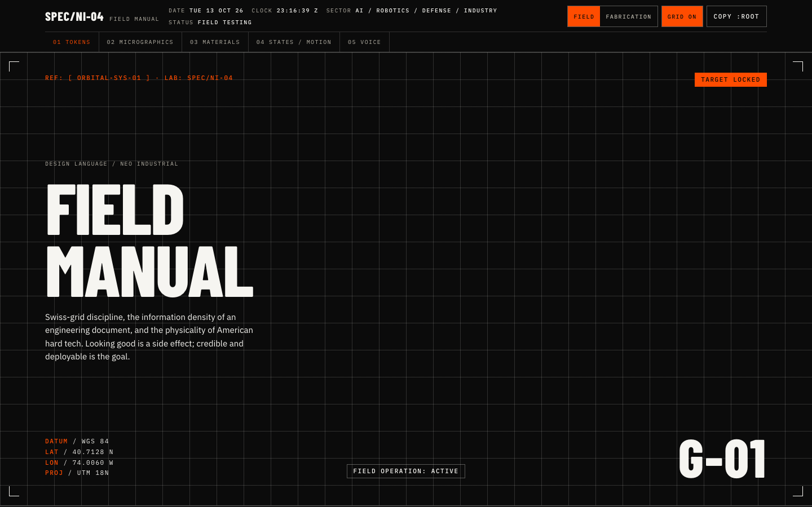
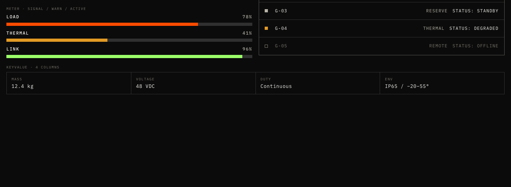
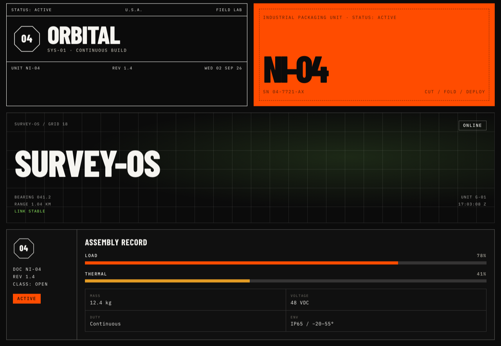
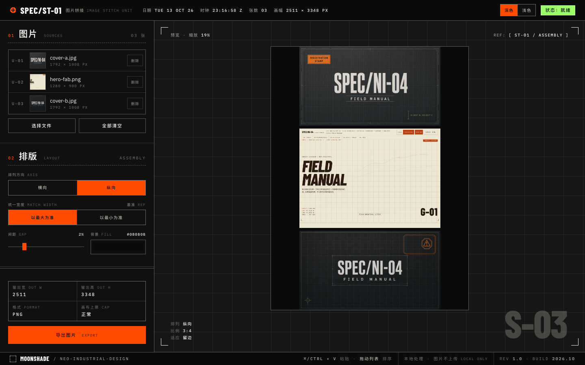

# NEO INDUSTRIAL — SPEC/NI-04

[English](README.md) · **简体中文**

`STATUS: FIELD TESTING` · `REV 1.0` · `LICENSE: MIT`

一套让界面读起来像工程文件的设计系统：把瑞士网格、技术规格书、工厂标识和航空图形用到屏幕上。一个信号色、细线结构、大写等宽标签、可见网格，不做任何装饰。

> 如果它不能印在铭牌、纸箱侧面或工装夹克上，就还没做完。



## 仓库内容

| 路径 | 内容 |
| --- | --- |
| [`DESIGN.md`](DESIGN.md) | 完整规范（英文）：语气、颜色、字体、间距、网格、动效、图形语汇、组件索引。从这里开始读。 |
| [`styles.css`](styles.css) + [`tokens/`](tokens) | 以 CSS 自定义属性形式提供的设计 token：基础色值、语义 token、两套配色氛围。 |
| [`components/`](components) | 22 个 React 组件，分四组（core、structure、materials、micrographics）。每个组件都有 `.jsx`、`.d.ts` 和一份 `.prompt.md` 用法说明。 |
| [`guidelines/`](guidelines) | 17 张规范卡片，覆盖颜色、字体、间距和品牌规则，可直接用浏览器打开。 |
| [`ui_kits/field-manual/`](ui_kits/field-manual) | Field Manual：一页式文档，同时也是参考 UI。 |
| [`examples/image-stitcher/`](examples/image-stitcher) | 用这套语言做的一个可用工具。 |
| [`archive/grok-v1/`](archive/grok-v1) | 用 Grok Build 生成的第一版，作为来源记录保留。 |
| [`SKILL.md`](SKILL.md) | 把仓库当作 Claude skill 使用时的入口。 |

## 快速预览

用浏览器打开 [`ui_kits/field-manual/field-manual-standalone.html`](ui_kits/field-manual/field-manual-standalone.html)。这是一个完全自包含的单文件，不需要构建，也不需要起服务。

## 使用 token

```html
<link rel="stylesheet" href="styles.css">
```

组件和自定义 CSS 只读取**语义** token，不直接用基础色值：

```css
.panel {
  background: var(--surface-elevated);
  color: var(--text-primary);
  border: var(--hairline) solid var(--border-strong);
}
.panel .label {
  font: var(--weight-mono) var(--text-stamp) / 1 var(--font-mono);
  letter-spacing: var(--track-stamp);
  text-transform: uppercase;
  color: var(--text-muted);
}
```

两套配色氛围共用同一组语义名称，切换只需要一个属性：

| 氛围 | 用法 | 配色 |
| --- | --- | --- |
| **Field**（默认） | 不用设置 | 黑底白字，安全橙 `#FF4C00` |
| **Fabrication** | `<html data-atmos="fab">` | 米色、沙色、深棕，铁锈色 `#B84312` |

## 硬性规则

- 每个界面只有一个强调色。状态色（在线绿、降级琥珀、告警红）不算强调色。
- 零圆角，无阴影，无渐变，无模糊。
- 不用 emoji，不用图画式图标。含义靠等宽标签、状态戳和 8px 的状态方点来表达。
- 标签一律用大写等宽字，写成 `KEY: VALUE` 形式。每一页至少有一个状态戳。
- 动效是机械式的：80 / 140 / 220 ms，曲线 `cubic-bezier(0.2, 0, 0, 1)`。不用弹簧，不回弹。
- 验收测试：关掉信号色、关掉微图形、转成灰度，画面仍然要读得出是一份工程文件。

## 组件



| 分组 | 组件 |
| --- | --- |
| core | Button、Stamp、SegmentedControl、Meter、KeyValue、StatusList、Toast |
| structure | CommandHeader、SectionHead、Plate、GridField、Corners、CoordBlock、UnitId、Heading、Label |
| materials | Mark、Lockup、HudPanel、SpecSheet、PackPanel |
| micrographics | Micrographic（index、scan、scanlines、octagon、chamfer、cut、cross、barcode） |



组件是普通的 React 代码，用内联样式读取 token。没有发布 npm 包，需要哪个就复制哪个文件。`_ds_bundle.js` 是所有组件预先打包好的浏览器版本（挂在 `window.NeoIndustrialDesignSystem_fae892` 上），参考 UI 和规范卡片都用它。

## 示例：图片拼接工具

[`examples/image-stitcher/index.html`](examples/image-stitcher/index.html) 是一个单文件小工具：把多张图片横向或纵向拼成一张，可以按原比例导出，也可以选 1:1、4:3、16:9 或自定义比例（留边或裁切）。它展示了这套系统用在真实可用界面上的样子：带实时状态戳的指令栏、编号的规格侧栏、可见网格，以及 Field 和 Fabrication 两套配色。界面为中文，配英文注释。所有处理都在本地完成，图片不会离开浏览器。



## 作为 Claude skill 使用

```bash
git clone https://github.com/CloudyMoonShape/neo-industrial-design.git ~/.claude/skills/neo-industrial-design
```

之后在 Claude Code 里输入 `/neo-industrial-design`，或者直接说要做一个「Neo Industrial 风格」的东西。这个 skill 会在动手前先读 `DESIGN.md`、token 和组件说明。

## 字体

工具包用三款 Google Fonts 作为替代：**Barlow Condensed**（展示标题和小标题）、**IBM Plex Sans**（正文）、**IBM Plex Mono**（所有操作标签）。正式目标字体是 Displaay 的 Saans，属于商业字体，不包含在仓库里。替换时只改 `tokens/fonts.css` 和 `tokens/typography.css` 里的字体族，其他 token 都不用动。

## 来源

第一版是用 Grok Build 生成的一页式 Field Manual。这个仓库是第二版：经过评审，整理成分层的 token 和组件，并补齐了文档。第一版保留在 [`archive/grok-v1/`](archive/grok-v1) 中。

这套系统已经做了匿名化处理。它是从防务、机器人和工业设计领域的公开素材中提炼出来的，但其中不出现任何真实的个人、工作室、客户名称或客户标识。

## 许可证

[MIT](LICENSE) © 2026 MoonShade
